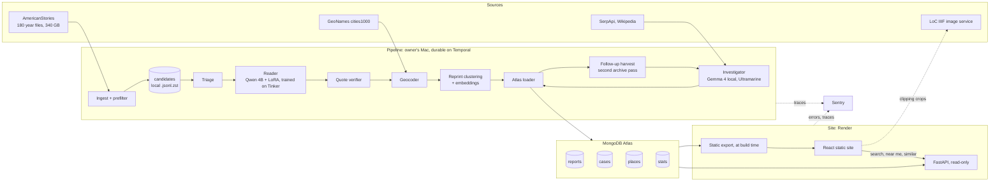
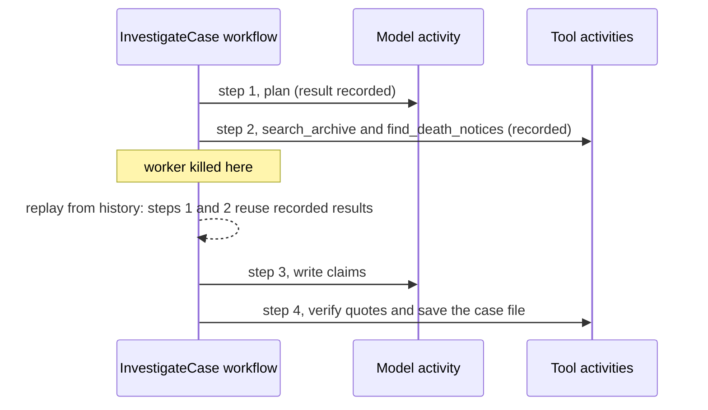

# Architecture: Paper Ghosts

How the system is built and how data moves through it. The spec is `BRIEF.md`, requirements with IDs are in `SRS.md`, and the build order is `BUILD-PLAN.md`. Where this file and `BRIEF.md` disagree, `BRIEF.md` wins and this file gets fixed.

## 1. Shape of the system

Two halves that never block each other:

- **The pipeline (offline, on the owner's Mac, durable on Temporal).** It reads the 340 GB archive, trains and runs the reader, geocodes, loads Atlas, gathers follow-ups and runs the investigator. All AI work happens here. None of it runs when someone visits the site.
- **The site (online, on Render).** A React static site plus a read-only FastAPI service over MongoDB Atlas.
  - The core path (front page, town, case) is served from prebuilt static JSON, so a visitor's first click never waits on a sleeping server.
  - Live features (archive text search, near me, ghosts like this one) call the API.

Clipping images come straight from the Library of Congress IIIF service. Crops for the front page and the top cases are also cached as static files, so the best material survives an LoC outage.



## 2. Components

| Component | Job | Built with | Runs |
|---|---|---|---|
| Ingest | Stream each year file, parse pages, prefilter articles, write candidates, counts and recall samples | `httpx` streaming, `tarfile` in `r\|gz` mode, `orjson`, `zstandard` | One Temporal activity per year file |
| Triage | Drop candidates whose every match is a known idiom ("Holy Ghost", "ghost of a chance", "gave up the ghost"), only if the eval shows it loses no reports | Rules, measured on the gold set | Pipeline |
| Reader | Classify each candidate and extract fields, each with a verbatim quote | Qwen 4B student with a LoRA trained locally with mlx-lm from a local teacher's labels (decision 39) | Full pass locally in Ollama, offline |
| Quote verifier | Keep a field only if its quote is found in the OCR text, allowing for OCR noise | `rapidfuzz`, threshold calibrated on the gold set | Pipeline and investigator |
| Geocoder | Publication place from the LCCN title; article places from the reader | GeoNames `cities1000`, offline, with a manifest | Pipeline |
| Reprint clustering | Group printings of the same story across papers (syndication was common) | Shingle links as blocking. Each printing joins a story only by matching its first printing directly, so nothing chains (decision 36) | Pipeline |
| Embedder | Vectors for "ghosts like this one" | An open embedding model through Ollama; dimensions chosen to fit the Atlas budget | Pipeline only; the site reuses stored vectors |
| Atlas loader | Upsert reports, places, cases and stats; create indexes | PyMongo | Pipeline |
| Follow-up harvest | Second streaming pass over only the years the top cases need: follow-ups, death notices, inquests, debunkings | The ingest code with per-case patterns | Temporal workflow |
| Investigator | An agent that writes a case file in which every claim cites a clipping | Gemma 4 26B-A4B through Ollama by default; Ultramarine as the comparison run; tools for archive search, Atlas, SerpApi and Wikipedia | One Temporal workflow per case; every model call and tool call is an activity |
| Static export | Prebuilt JSON for the front page, the town index, each town, each case and the archive chart | Python script reading Atlas | At deploy time |
| API | Text search, near me, similar, printed-on-this-night, stats, health | FastAPI, PyMongo async | Render web service |
| Web | Every page, built on the design system from `UI-IDEAS.md` | React, Vite, TypeScript | Render static site |
| Observability | Errors and traces, including token counts and cost per model call | Sentry: `paperghosts-api` for the API and the pipeline (tagged by environment), `paperghosts-web` for the site | Everywhere |

Temporal runs only on the owner's machine, through the CLI dev server. The live site never needs it.

## 3. Data flow, step by step

### 3.1 Ingest (`IngestArchiveWorkflow`)
- **Input:** a list of years, all 180 by default, read from the dataset's 2025-03-26 commit (`77e27fa6`), not `main`.
- **Output per year, under `data/`:**
  - `candidates/{year}.jsonl.zst`: articles that hit the lexicon, with the matched terms, page metadata and scan location
  - `counts/{year}.json`: pages, articles and candidates, broken down by state and by term
  - `samples/{year}.jsonl.zst`: seeded reservoir samples of 2,000 non-candidates and 2,000 articles from the near-miss pool (articles with words like "knocking", "strange noises" or "spirits" but no ghost term). Both feed the recall measurement.
  - `manifests/{year}.json`: source URL, dataset revision, bytes read, lexicon and code versions, start and finish times, and each output's size and sha256
- **One activity per year file:** stream, gunzip, and read tar members one at a time. The tarball never touches the disk.
  - Heartbeats carry progress (members done, bytes read).
  - Retry policy: exponential backoff with a bounded number of attempts.
- **Idempotent:**
  - Outputs are written to a partial file named for its process, and renamed when complete.
  - A year is skipped when its manifest matches the cache key (dataset revision, lexicon version, code version) and every output on disk has the sha256 the manifest records.
  - An attempt stops at its next heartbeat, before it writes anything, once it is cancelled or its worker is gone.
  - A killed worker re-runs only unfinished years. The year in flight restarts from its beginning, because a gzip stream can't seek. The kill-test write-up says so.
- **Concurrency:** bounded, starting from what Phase 1 measures for download speed and parse speed on this machine (10 cores).
- **Disk:** about 35 GB is free, so all ingest outputs together must stay under 10 GB, measured and reported.

### 3.2 Gold set and reader
- **Gold set:**
  - 150–300 candidates, stratified by decade and lexicon term and including near-miss items.
  - Frozen before any training: the split and its hash are committed under `eval/gold/`.
  - The build agent labels it before seeing any model output, from the OCR text and the scan crop where the OCR is unclear.
  - The labelling rules for hard cases (séance reports, reprinted fiction, hoax exposures, humour columns) are written in `eval/gold/POLICY.md` before labelling starts.
- **Training data:** the teacher labels a separate pool. No gold article, and no reprint of a gold article, may appear in it.
- **Model selection** happens on a dev split. The gold set is touched only for final evaluations.
- **Full pass:** the tuned student reads every triaged candidate and writes `data/reader/{year}.jsonl.zst`. Every field either passes the quote verifier or becomes "not stated".

### 3.3 Geocode, cluster, embed, load
- Places are resolved against GeoNames. Every location records its precision (town, street or building) and its source. Street or building coordinates exist only when a source supplies them.
- The title lookup by LCCN (`scripts/titles.py`, decision 34) holds:
  - each paper's title, place and state as printed
  - what the cataloguer supplied
  - its place as its loc.gov title record catalogues it today, where the record was fetched
  - its state today
- The site shows the printed place, with what has changed since: "Charlestown, Va. (now W.Va.)". It names the record's town only where the paper's point is the record's place: "East Saginaw, Mich. (now Saginaw)".
- A paper's point is its printed place, checked against its title record's county (`paperghosts/geo/papers.py`). A place outside that county gives way to the record's place. Where nothing agrees with the record, there is no point.
- Printings of the same story are grouped. Counts on the site say which they count: stories or printings.
- Stories get one embedding each, from the earliest legible printing.
- The loader upserts by stable IDs, so re-running it is safe.

### 3.4 Follow-up harvest
- The top 30–60 cases are picked by a written, versioned rule: a verified place, named people or a specific place, and a legible clipping.
- The years those cases need are grouped, and each year file is streamed once.
- From each stream, the harvest pulls articles that match a case's named people, its specific place, or its town within a date window.
- Output goes to `data/harvest/{case_id}.jsonl`.

### 3.5 Investigator (the main Temporal story)
- `InvestigateCaseWorkflow(case_id, model)` runs a loop: plan, call tools, read, write claims, verify.
  - Every model call and every tool call is an activity, with an idempotency key made from the workflow ID and the step number.
  - Temporal records each result in the workflow history. After a crash the workflow replays and reuses those results, so no completed model call or web search is repeated.
  - A call that is in flight when the worker dies has no recorded result, so Temporal retries it. The idempotency key lets a provider that supports one drop the duplicate, and the kill test counts these retries rather than claiming there are none.
- **Tools:**
  - `search_archive` over the harvested and candidate articles, using a local full-text index and Atlas Search
  - `get_article`
  - `find_death_notices(name, place, window)`
  - `web_search` through SerpApi, with a budget counter that persists across runs
  - `wikipedia` for the "now" side when the SerpApi budget runs out (the card says so)
- **Guardrails in code, not just in the prompt:**
  - A claim is kept only if it cites at least one clipping and its quote verifies against that clipping. Dropped claims are logged with the reason.
  - A cause of death is stated only as printed.
  - The link between a ghost and a death is graded strong, possible or weak, with its reasons listed (name match, place match, date gap).
- **Output:** a `cases` document, plus one Sentry trace per case with a span per step carrying model, tokens, cost and latency.
- **Budgets:** a maximum number of steps per case, a maximum number of web searches per case, and a global SerpApi counter (the free plan is 250 searches a month).



### 3.6 Static export and the site
- `export_static` reads Atlas and writes:
  - `front.json`: printed-on-this-night candidates, ticker headlines and totals
  - `towns/index.json`: a compact town index for search on the device
  - `towns/{place_id}.json` and `cases/{report_id}.json`
  - `reel.json`: the archive chart
- The API contract is in `SRS.md` section 6.
- Both services are defined in `render.yaml`. Nothing deploys until the owner says yes.

## 4. Data model (MongoDB Atlas, database `paperghosts`)

The Pydantic models in `paperghosts/schemas` are the single source of truth.
- `make db-init` generates Atlas's JSON Schema validators from them (strict, with errors) and builds the collections and indexes below (`paperghosts/store/db_init.py`).
- Atlas holds stories, places, cases and stats only, built to M0's limits and decision 32's rules.
- A field with no value is left out of the stored document, not stored as null.

**`reports`:** one document per story.
- `_id`, which is `r_` plus the primary article ID, and `primary_article_id`, the earliest printing's
- `printings[]`: compact references (decision 32, rule 6), built by `paperghosts/store/printings.py`. Each has:
  - article ID, LCCN, paper title, publication place, state and date
  - edition, reel, issue and frame, from its member name. The issue is the date and a two-digit edition.
  - page, from the scan record only, when it has one
  - the page's IIIF `service`. It comes from the scan's batch path (decision 33). A page with none gets its batch from the reel-to-batch map or loc.gov, and is shown only once the page check confirms it (decision 35).
    - Where only the frame differs, the service takes the member's frame, which was the page in 18 of 18. Where the reel differs too, the batch path's page stands. Either way the page is checked before its crop is shown (decision 35).
  - `bbox_list`

  Crop URLs are derived from `service` and `bbox_list` when a printing is read, never stored, and a printing keeps no text of its own.
- `headline` and `text`, the OCR of the primary printing, untouched
- `display_headline`: the headline without the masthead lines that lead it
- `date` (the earliest printing's), and `year`, `month_day` and `decade`, which the model checks against it
- `kind`, always `report` in this collection
- `fields`: each is `{value, quote, verified, score}`. A value needs a quote that verified, and both the model and Atlas's validator enforce it. A field without one is "not stated" and has no value.
  - `place`
  - `people[]`
  - `seen`
  - `outcome`: unexplained, explained, hoax or unknown
  - for walks:
    - `specific_place`
    - `place_type`: house, church, cemetery, inn_or_hotel, road_or_bridge, public_building, ship or other
    - `precision`: town, street or building
- `location`: a GeoJSON point, with `location_precision` and `location_source`
- `place_id`, `town` and `state`
- `embedding`: a BinData vector of 384 dimensions, float32 or int8, never an array of doubles (rule 6)
- `versions`: the code's git SHA, and the versions of the lexicon, the reader's model, its adapter and its prompt (SRS section 5)
- `lexicon_terms[]`: the lexicon rules that matched, by name
- `case_id`, which is `c_` plus the report's `_id`, when an investigation exists

**`places`:** `_id` is the GeoNames ID. Each place also has its name, alternate names, state, location, report count, first and last year, and versions.

**`cases`:**
- `_id`, which is `c_` plus the report ID, and `report_id`
- `claims[]`: each has its text, a confidence, and at least one clipping it cites (article ID, quote, verified)
- `followups[]`: each is a printing reference with its relation and quote. The relation is follow_up, debunking, arrest, moved_out, inquest or death_notice. Crop URLs are derived as a report's are.
- `person`: name, death-notice article, link grade (strong, possible or weak) and reasons
- `then_now`:
  - the "then" side
  - the "now" items, each with source, URL, retrieval date and quote
  - the differences, each backed by both quotes
- `run`: model, provider, steps, tokens, cost, latency, Sentry trace ID and Temporal workflow ID
- `versions`

**`stats`:** one document per year (`_id` `year:1875`) and one per state (`state:New York`). Each holds:
- pages, articles, candidates, stories and printings
- reports per million articles
- stories by outcome, precomputed for the reel so that outcome needs no index (rule 4)

**Indexes:** the category fields get none of their own (rule 4): outcome, kind, place type, precision, decade and state.
- `reports`:
  - a 2dsphere index on `location`
  - compound `{place_id, date}` and `{month_day}`
  - a partial unique index on `case_id`, which holds only the 30–60 investigated stories
  - Atlas Search `reports_search`, a static mapping (rule 5) used with fuzzy matching:
    - headline, display headline, text, town and the reader fields' values, as strings
    - state, and the reader's outcome, place type and precision, as tokens
    - decade, as a number
    - no printings and no quotes
  - Vector Search `reports_vector` on `embedding` (384 dimensions, cosine), with filters on state and decade
- `places`:
  - 2dsphere on `location`
  - Atlas Search autocomplete `places_search` on name and alternate names, with state as a token
- `cases`: unique `{report_id}`

M0 allows three Search indexes in the whole cluster, and the plan uses all three. `sample_mflix.movies` holds one (`default`), so `places_search` waits on the owner (decision 33).

**Storage budget:**
- M0 counts data size plus index size against its 512 MB.
- Candidates and reader outputs stay local, and the article says so.
- `BUDGET.md` has the measured bytes per story and how many stories fit (decision 33).

## 5. Repo layout

```
Makefile                 setup, keys, temporal, worker, smoke, ingest, eval, db-init, db-verify, api, web, app, test, lint, numbers
pyproject.toml           one uv project, Python pinned in .python-version
paperghosts/             the Python package
  config.py              reads .env; never prints a value
  schemas/               Pydantic models (single source of truth)
  ingest/                streaming reader, lexicon, prefilter, samples
  reader/                prompts, Tinker training and sampling, local runner, quote verifier
  geo/                   GeoNames loader, LCCN title parser, geocoder
  cluster/               reprint clustering, embeddings
  store/                 Atlas loader, indexes, validators, static export
  investigator/          agent loop, tools, guardrails
  workflows/             Temporal workflows, activities, worker
  observability/         Sentry setup and model-call spans
api/                     FastAPI app (read-only)
web/                     React + Vite + TypeScript site and design system
eval/
  gold/                  split, hash, labelling policy (committed)
  results/               JSON and charts for evals A to D (committed)
scripts/                 one-off checks: keys, crop check, offline proof, numbers sheet
tests/                   unit, integration (Temporal test env), API contract
data/                    local only, gitignored except small manifests and per-year counts
Docs/                    BRIEF, ARCHITECTURE, PRD, SRS, BUILD-PLAN, DECISIONS, RESUME, UI-IDEAS (IDEAS.md stays private)
.github/workflows/       CI
render.yaml              deploy blueprint (used only after the owner's yes)
```

## 6. Environments and delivery
- **Local:** `make temporal`, `make worker`, `make api` and `make web` run everything on the owner's machine.
- **CI (GitHub Actions):** lint, offline tests, a web typecheck and build, and a secret scan, on every push and pull request. CI needs no secrets; tests that need the network are marked and skipped there.
- **CD (Render):** a Blueprint with an API web service and a static site. It auto-deploys from `main` only after the owner approves the first deploy.
  - Render environment variables are set by the owner.
  - Atlas network access must allow Render's servers; that change also needs the owner's yes.
- **Releases:** Sentry releases are tagged with the git SHA.

## 7. Security and privacy
- **Secrets:**
  - Secrets reach code only through environment variables.
  - `config.py` redacts them in `repr`, logs and errors.
  - The Ultramarine key is named `PAPERINSTRUMENTS_API_KEY` in `.env`; config also accepts `ULTRAMARINE_API_KEY`.
- **Sentry:** `send_default_pii=False`, and a `before_send` hook strips coordinates and query strings.
- **Near me:** coordinates are rounded to about 1 km on the device and again on the server, used for that one query, and never logged.
- **Secret scanning:** a scanner runs in CI.
  - Entire is on with telemetry off, and its checkpoints sync to the private `origin`.
  - Before the repo goes public, the Entire checkpoint refs and the recorded sessions are scanned for secrets.
- **The people in the archive:** nobody is named except as the papers printed them, and nothing about how they died is guessed.

## 8. Architecture risks and what answers them

| Risk | Answer |
|---|---|
| Ingest is limited by CPU, not network | Measure parse speed in Phase 1 and set concurrency from it |
| Too many candidates for the reader budget | A triage stage measured for recall, plus cost per 10,000 articles and a Tinker credit check before the full pass |
| Reprints inflate counts and leak gold into training | Reprint clustering, counts labelled as stories or printings, and a leakage check script |
| Rough OCR | Fuzzy quote verification, and optionally Gemma re-reading the scan image when the OCR is unreadable |
| LoC image service is slow or down | Lazy loading, cached crops for the top content, and a text fallback |
| Render free services sleep | The core path is served from static JSON |
| Atlas free tier is 512 MB | Only stories go to Atlas; the bulk stays local and the article says so |
| Gemma 4 26B on 24 GB of RAM | Never run it alongside the local student; measure tokens per second in Phase 1 |
