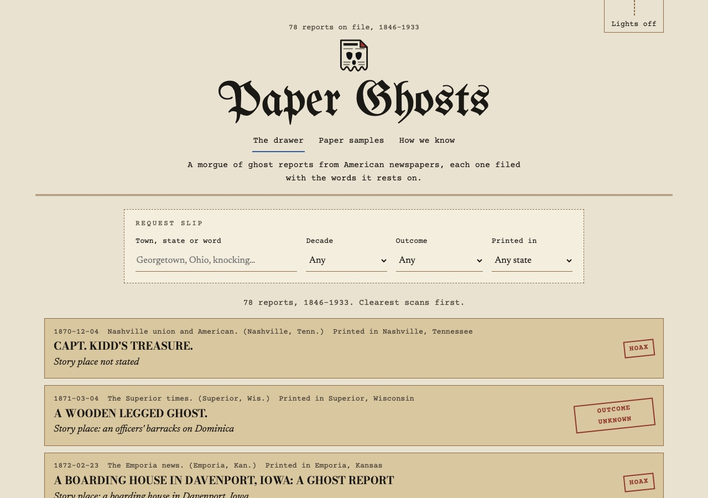
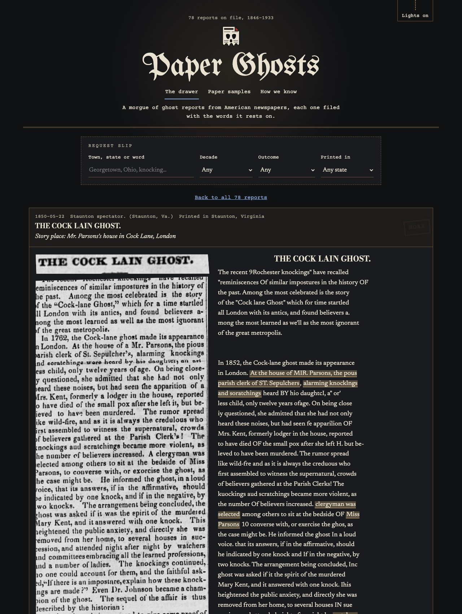
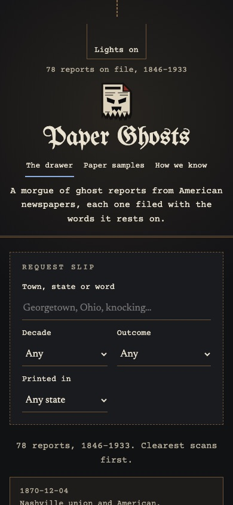

<!-- DRAFT for the owner to publish. Images use the repo's raw URLs on main, which work once the repo is public and the PR is merged; or upload them to DEV. Every number here comes from `uv run python scripts/article_numbers.py` (eval/results/numbers.json). -->

*This is a submission for the [Hacktoberfest Open-Source AI Challenge: Week 4](https://dev.to/challenges/hf26), "Ghost in the Machine".*


In 1870 an empty mansion stood in the middle of Springfield, Ohio. People who passed it at midnight "saw strange lights and heard stranger sounds". Two young men of the town spent a night there to settle it. Nine years later a Pennsylvania paper, the *Cambria Freeman*, printed how it ended. A gang of robbers had been hiding behind a secret door, and when the curious came to see the ghosts, the robbers drove them off "by means of a magic lantern".

That's a ghost in the machine, in 1879: a projector making a haunting. It's also report number one in **the Morgue**, a small archive of ghost reports from American newspapers. Each report is filed with the exact words of the scan it rests on, and with a link to the page at the Library of Congress.

Halloween is half of this week's theme. Día de los Muertos is the other half, and it suits the Morgue better, because these reports are about real people, named by their own papers. They include Detective John Burnside, who caught the Springfield gang, and Miss Parsons, the parish clerk's daughter at Cock Lane, twelve years old, who heard the knocking. The Morgue remembers them in the words that were printed about them, and adds nothing.

## What I Built

**Paper Ghosts** reads the American newspaper archive for ghost reports and files each one with the scan's own words, never a retelling.

- **The archive screen.** All 370,313,913 articles on 16,887,460 pages of the AmericanStories dataset, the OCR of the Library of Congress's Chronicling America, went through a ghost-word screen.
  - The screen flags 1,236,122 candidates.
  - Chaining the reprints that papers copied from one another leaves 974,399 distinct stories.
- **A gold set, labelled twice and ruled blind.** 300 gold and 150 dev articles were drawn across 17 strata and labelled one at a time against a written policy.
  - A blind second pass relabelled all of gold, and agreed on kind for 271 of 300 (86–93%, κ 0.88).
  - Fresh judges re-ruled every disagreement without seeing who said what. Where their ruling differed from the first, the blind ruling stood in 28 of 30.
  - Gold holds 46 reports. That puts the weighted rate of ghost reports among candidates at 0.97% (0.38–1.81%).
- **The Morgue,** the demo. It holds the 78 reports among those 450 articles. Each one shows the clipping beside its transcription, the quoted words marked, and an index card that says **Not stated** wherever the paper didn't say.
- **A teacher benchmark.** Two open-weight models were scored as the teacher that will label training data for a small reader: Qwen3.5-397B on Tinker, and gemma4:26b on this laptop.

**What it isn't yet:** the trained reader that would label the whole archive is future work, for the reasons in "Why open innovation matters" below. The Morgue shows hand-checked reports, not machine output, and it says so on the page.

## Demo





The Morgue is a static site with no server, so it runs with the internet off:

```bash
git clone https://github.com/Hotragn/Paperghosts && cd Paperghosts
pnpm --dir web install && pnpm --dir web build && pnpm --dir web preview   # http://localhost:4173
```

It has three rooms:
- **The drawer:** search by town, state or word, and filter by decade, outcome, and the state the paper was printed in.
- **Paper samples:** the clearest scan for each way a report can end, captioned only with its own quoted words.
- **How we know:** every figure in this post, with its interval, read from the numbers sheet.

<!-- Render: add the live URL here once the owner deploys render.yaml. -->

## How I Built It

### Open weights do the reading, and every value carries its quote

A reader that paraphrases makes up ghosts. So every field (place, what was seen, how it ended, who saw it) must carry the **verbatim** words that state it, and a quote verifier drops any value whose quote isn't in the text. The verifier's threshold was set on dev, at the point where no quote borrowed from another article passes.

The teacher benchmark on the 150 dev articles, after the verifier, with 95% Wilson intervals:

| | Qwen3.5-397B (Tinker) | gemma4:26b (this laptop) |
|---|---|---|
| Kind | 112 of 150 (67–81%) | 100 of 150 (59–74%) |
| Report or not | 139 of 150 (87–96%) | 134 of 150 (83–93%) |
| Reports found | 23 of 32 (55–84%) | **24 of 32 (58–87%)** |
| The story's state | 13 of 23 (37–74%) | **22 of 24 (74–98%)** |
| Outcome, as scored | 16 of 23 (49–84%) | 5 of 24 (9–40%) |
| Outcome, format normalised (scoring only) | 16 of 23 | 20 of 24 (64–93%) |

**The most useful finding was format, not judgment.** gemma4's outcome scored 5 of 24, which looks like it can't judge an ending. But 18 of its 19 misses wrote the outcome as a bare word with no quote, and the parser rightly dropped those. Read as values, it scores 20 of 24. A training label still needs its verified quote, so the fix belongs in the prompt, never in the scorer.

The 397B's misses on the story's state were the opposite: judgment. It filled in a state from a paper's name or a bare town, which the policy forbids.

### Why open innovation matters for this

This project ran into the closed-service trap halfway through.

The teacher rounds ran on **Tinker**, with the 397B. Then the account's credit balance turned out to be **$0**, and the day's runs ($3.19–14.45 by their recorded tokens) went to the owner's card. The owner stopped all Tinker spend, and sampling is now off in code. At the measured rate, the 397B would cost $65–297 per 10,000 articles, depending on how much of the prompt is cached.

Because the weights are open, the reading didn't stop. It moved to the laptop:
- **gemma4 on a 24 GB Mac** found as many of dev's reports as the 397B (24 against 23 of 32, with overlapping intervals). It got the story's state right far more often.
- **It works with the lights and the internet off.** The Morgue is a static build. gemma4's dev answers were produced on this laptop through Ollama, and nothing about the archive left the machine to make them.
- **Nothing is locked in.** The labels, the prompt, the policy and the scores are files in the repo, and the next reader can be any open model that fits.

The cost of local is time and memory. With thinking off, gemma4 reads 244 articles an hour, or 12.3 hours for a 3,000-article training draw. With thinking on, its six measured articles took 2.4–8.1 minutes each. Running gemma4 and a training job side by side once froze the laptop. That's why training the reader is future work: it comes next, one model at a time.

### MongoDB Atlas: the Morgue's data layer

- **The reports:** all 78 are stored as schema-validated `Report` documents in `paperghosts.reports`, 140 KB in all.
- **Fuzzy Atlas Search:** OCR is cruel, and fuzzy matching forgives it. A search for **"apparition"** finds the Cock Lane report through its scan's **"apparilion"**, and the Memphis college report through "Appar'tIon" (`Docs/demo/atlas_search.txt`).
- **Ghosts like this one:** Atlas Search's `moreLikeThis` gives each report's five nearest reports, median 68 ms. The static site keeps Atlas's answers.
- **Near this town:** the 46 towns where the papers were printed are geocoded from GeoNames into `paperghosts.places`, behind a 2dsphere index. A `$geoNear` finds papers printed within 250 km of Philadelphia, or 600 km of Kansas City, in about half a second.
  - This is labelled as the papers' towns, never the stories'. A story's place is only what the text states, and only 14 of the 78 state a state.
- **Vector Search** isn't live. The `reports_vector` index is built for 384-dimension vectors, but the free Hugging Face inference credits for an open embedding model ran out. Until then, `moreLikeThis` does "ghosts like this one".

### Sentry: tracing every Atlas query, and the fix it led to

The API's search and "ghosts like this one" routes, and the scripts, run each Atlas query in a Sentry span (`db.atlas.query`). Each span carries the query's kind and latency, never the words searched for, and releases are commits.

The traces showed every "ghosts like this one" request paying for two round trips: a `find` for the report's text (p50 41 ms), then the `moreLikeThis` (p50 66 ms). A report never changes within a release, so the API now reads each one once. A repeat request went from **110 ms to 61 ms** at the median, and from 123 to 68 ms at p95 (decision 40).

To be plain about scope: Sentry here traces the database queries and the web app (page loads, errors, source maps for each release). The model calls in this project ran before the tracing existed, so there are no agent or LLM spans to show, and none were invented after the fact.

### Entire: the build's paper trail

Every commit carries an `Entire-Checkpoint` trailer that points to the recorded agent session that made it. Two of them show the problem solving best:
- **The reprint-chaining fix** (59,983,120 tokens over 73 API calls): chained clusters grew through near matches, so a printing now joins a story only by matching its first printing directly.
- **A judge ruling its own case, caught** (26,688,512 tokens over 34 calls): the first rulings came from the first labeller. Fresh judges re-ruled all 69 disputes blind.

Entire also redacts secrets on its own. Our scan of all history and every checkpoint found no keys. It did find something else: an early session's process listing named another account on this Mac. We backed up all the checkpoints, rewrote the 121 affected ones so each listing became one redaction line, recomputed Entire's content hashes, and tested with `entire checkpoint explain` and `entire doctor` before pushing. A private Entire rule pack, never committed, now keeps that name out of new checkpoints.

### Render

`render.yaml` deploys the Morgue as a static site: it builds `web/` and publishes `web/dist`, with no keys in the bundle. The two Sentry keys are set in Render's dashboard, never committed.

<!-- Render: replace with the live URL and a line on the deploy once the owner has deployed. -->

## Disclosures

- **Claude labelled the evaluation set.** The 450 gold and dev labels were made one article at a time by Claude, working against the written policy. A blind second pass and the re-rulings came from separate Claude judges that couldn't see the first labels. Claude also wrote the code, under the owner's direction.
- **Open models do the reading.** The teachers scored here are open-weight models. Training labels will come only from an open model run locally, never from Claude. Gold and dev are kept for evaluation only.
- **The trained reader is future work.** The Morgue shows the 78 labelled reports, not a model's output.
- **Data:** article text from AmericanStories (Harvard's Dell Research, CC-BY-4.0); page scans from the Library of Congress's Chronicling America (no known copyright restrictions).

## Prize categories

- **Gemma:** gemma4:26b as the local teacher. The benchmark, the format-against-judgment finding, and its recorded dev outputs.
- **MongoDB Atlas:** fuzzy Atlas Search, `moreLikeThis`, `$geoNear` on the papers' towns, and schema-validated documents.
- **Sentry Agent Tracing:** spans on every Atlas query, the fix they found, and the web app's tracing. No agent spans, as stated above.
- **Entire:** the session trail, the token figures, and the redaction.
- **Tinker:** the 397B teacher benchmark, its measured cost, and the spend stop.
- **Render:** the static-site blueprint, once deployed.

The code is MIT licensed: [github.com/Hotragn/Paperghosts](https://github.com/Hotragn/Paperghosts).

-30-
