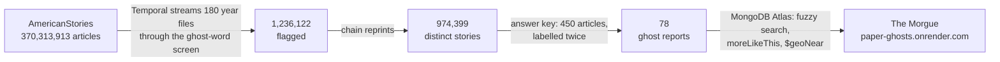

<div align="center">


# Paper Ghosts

**Real ghost reports from old American newspapers, each shown with its original scan and the exact words behind every fact. It never writes a ghost story.**

[](https://paper-ghosts.onrender.com)
[](https://github.com/Hotragn/Paperghosts/actions/workflows/ci.yml)
[](LICENSE)
[](https://huggingface.co/datasets/dell-research-harvard/AmericanStories)
[](#contributing)
[](https://dev.to/hotragn/paper-ghosts-i-screened-370-million-old-newspaper-articles-for-ghosts-one-was-a-magic-lantern-11b)

[](.python-version)
[](web/)
[](paperghosts/workflows/)
[](scripts/load_demo_atlas.py)
[](paperghosts/observability/)
[](eval/results/phase2c/)

**[Open the Morgue](https://paper-ghosts.onrender.com)** · [Read the write-up](https://dev.to/hotragn/paper-ghosts-i-screened-370-million-old-newspaper-articles-for-ghosts-one-was-a-magic-lantern-11b) · [Quick start](#quick-start) · [How it works](#how-it-works)

</div>


## Why it exists

Ghost stories get retold until nobody knows where they came from. The original reports still exist, in American newspapers the Library of Congress has scanned, but they are very hard to find:

- **There's too much to read:** 370,313,913 articles on 16,887,460 pages.
- **Most hits are noise:** only about 1 in 100 articles with ghost words is a real report of a haunting.
- **The text is broken:** OCR turns "apparition" into "apparilion", and papers reprinted each other's stories again and again.

Paper Ghosts screens the whole archive, chains the reprints, tests open-weight models against a labelled answer key, and shows each report with its scan. Every fact on a report (the place, what was seen, how it ended, who saw it) is a quote from the scan, or it says **Not stated**.

## At a glance

| | |
|---|---|
| Articles screened | **370,313,913**, every page of all 180 year files (about 340 GB) |
| Time to screen them | **just under 2 hours** on one laptop, through Temporal |
| Flagged by the ghost-word screen | **1,236,122** |
| Distinct stories once reprints are chained | **974,399** |
| Real ghost reports among flagged articles | **about 1 in 100** (0.97%, 95% range 0.38–1.81%) |
| Answer key | **450** articles, labelled twice, the second time blind (κ 0.88 on kind) |
| Reports in the live Morgue | **78**, printed 1846–1933 |

Every figure comes from `uv run python scripts/article_numbers.py`, which prints each one beside the file it was read from and writes them to `eval/results/numbers.json`.

## How it works



1. **Screen the archive (Temporal).** One workflow streams each year file straight from Hugging Face, four at a time, and never stores the tarballs. Each year is one activity that heartbeats every 200 pages. In the [kill test](eval/results/phase2a/kill-test-1.md), a SIGKILL of the worker's whole process group 27 minutes in cost under two minutes. The finished years stayed finished, and the four in flight retried from the top.
2. **Chain the reprints.** A printing joins a story only if it matches that story's first printing directly, so chains can't grow through near-matches.
3. **Build the answer key.** 300 test and 150 tuning articles, drawn across 17 slices of the archive, are labelled one at a time under [`eval/gold/POLICY.md`](eval/gold/POLICY.md). A blind second pass relabelled them, fresh judges re-ruled every dispute, and the labels were frozen by sha256 before any model output touched them.
4. **Enforce the quote rule.** Every field a reader returns must carry the verbatim words that state it, and a verifier drops any value whose quote isn't in the article. A reader that paraphrases makes up ghosts.
5. **Test open-weight readers.** Two teachers were scored on the 150 tuning articles (`eval/results/phase2c/`):

   | | Qwen3.5-397B (Tinker) | gemma4:26b (local, Ollama) |
   |---|---|---|
   | Report or not | 139 of 150 | 134 of 150 |
   | Reports found | 23 of 32 | **24 of 32** |
   | The story's state | 13 of 23 | **22 of 24** |
   | How it ended, format fixed (scoring only) | 16 of 23 | 20 of 24 |

6. **Serve from Atlas.** The reports are schema-validated `Report` documents. Fuzzy Atlas Search finds "apparition" through the OCR's "apparilion", `moreLikeThis` finds the five ghosts most like each one, and `$geoNear` finds papers printed near a town.
7. **Trace with Sentry.** Every Atlas query runs in a `db.atlas.query` span that records its kind and latency, never the words searched for. The traces showed a double round trip, and the fix cut a repeat request from 110 ms to 61 ms at the median ([decision 40](Docs/DECISIONS.md)).
8. **Ship on Render.** [`render.yaml`](render.yaml) builds `web/` into a static site. The bundle holds no keys.

## Quick start

### Look at it
Open **[paper-ghosts.onrender.com](https://paper-ghosts.onrender.com)**. There's no login.

### Run the site locally
No keys are needed.

```bash
git clone https://github.com/Hotragn/Paperghosts && cd Paperghosts
pnpm --dir web install
pnpm --dir web build && pnpm --dir web preview   # http://localhost:4173
```

### Run the pipeline
You need [`uv`](https://docs.astral.sh/uv/), Node with `pnpm`, the [Temporal CLI](https://docs.temporal.io/cli) and [Ollama](https://ollama.com). Keys go in `.env`, which git ignores.

```bash
make setup                        # the Python 3.12 environment and the web packages
make keys                         # checks every key by shape and one cheap call; never prints a value
make temporal                     # terminal 1: Temporal dev server, UI at http://localhost:8233
make worker                       # terminal 2: the Temporal worker
make ingest YEARS="1850 1910"     # terminal 3: stream two year files through the screen
uv run python scripts/article_numbers.py   # every figure, beside the file it came from
```

### Query Atlas
These read `MONGODB_URI` from `.env`.

```bash
uv run python scripts/load_demo_atlas.py                         # upserts the 78 reports; never deletes
uv run python scripts/query_demo_atlas.py "apparition"           # fuzzy Atlas Search
uv run python scripts/query_demo_atlas.py --like <article_id>    # ghosts like this one
uv run python scripts/load_demo_places.py load                   # the papers' 46 towns, from GeoNames
uv run python scripts/load_demo_places.py near Philadelphia Pennsylvania 250   # $geoNear
```

Sample outputs are in [`Docs/demo/`](Docs/demo/).

## Commands

| Command | What it does |
|---|---|
| `make setup` | Installs the Python 3.12 environment and the web packages |
| `make lint` | ruff, oxlint and the TypeScript check |
| `make test` | pytest, offline; the Temporal test starts its own throwaway server |
| `make keys` | Checks every key by shape and with one cheap call, and never prints a value |
| `make temporal` | The Temporal dev server, with its state in `data/temporal/` |
| `make worker` | The Temporal worker |
| `make smoke` | One workflow whose activity heartbeats, fails once on purpose, and recovers through its retry policy |
| `make ingest YEARS="..."` | Streams those year files through the screen; with no `YEARS`, every year. A year is skipped while its manifest matches the pinned dataset revision, the current code and every output's sha256 |
| `make api` | The read-only FastAPI app over Atlas at http://localhost:8000 |
| `make web` | The web app at http://localhost:5173 |
| `make app` | `make api` and `make web` together |

`make smoke` and `make ingest` need `make temporal` and `make worker` running.

## Project layout

```
api/            read-only FastAPI app over MongoDB Atlas (search, ghosts like this one)
paperghosts/    the Python package: ingest, workflows, cluster, store, geo, observability, schemas
scripts/        repeatable jobs: Atlas loaders and queries, exports, the numbers sheet
eval/           the answer key, its policy, and every results file
web/            the Morgue: TypeScript and React, built as a static site
tests/          the pytest suite, offline
Docs/           decisions, plan, architecture, brand, demo outputs and screenshots
```

## What it can't do yet

- **The trained reader isn't built,** so the archive-wide pass hasn't run. The Morgue shows the 78 reports in the answer key, not every ghost the papers printed.
- **The OCR is shown as printed.** A quote is only as good as the scan's text.
- **A story's place isn't geocoded.** Only the papers' own towns are, and only 14 of the 78 reports name a state.
- **Atlas Vector Search isn't on.** The free Hugging Face credits for an open embedding model ran out (HTTP 402), so "ghosts like this one" uses Atlas Search's `moreLikeThis` for now.

## Contributing

Issues and pull requests are welcome. The open items above are good places to start, and [`Docs/BUILD-PLAN.md`](Docs/BUILD-PLAN.md) has the plan.

```bash
make setup && make lint && make test
```

CI runs on every pull request. It runs ruff and pytest for Python, then oxlint, the TypeScript check and the build for the web app. It also scans the whole git history for secrets with gitleaks, so never commit `.env`.

## AI disclosure

- **Claude** wrote the code, under the owner's direction, and labelled the 450 answer-key articles one at a time under the labelling policy. The blind second pass and the re-rulings came from separate Claude judges that couldn't see the first labels.
- **Open-weight models do the reading.** Qwen3.5-397B through Tinker and gemma4:26b on a laptop were scored as teachers. Training labels never come from Claude, and the answer key is kept for evaluation only.
- **Entire** recorded every agent session. [`Docs/demo/entire_sessions.md`](Docs/demo/entire_sessions.md) points to two of them.

## Data and licences

- **Article text:** AmericanStories, from Harvard's Dell Research (`dell-research-harvard/AmericanStories`, CC-BY-4.0).
- **Page scans and clippings:** Library of Congress, Chronicling America (no known copyright restrictions).
- **Fonts:** UnifrakturMaguntia, Bodoni Moda, Newsreader and Courier Prime, self-hosted through Fontsource under the SIL Open Font License.
- **Open-weight models:** Qwen3.5-397B-A17B and Qwen3.5-4B (Qwen), and gemma4:26b-a4b-it-qat (Google).
- **Code:** MIT; see [LICENSE](LICENSE).

The brand (the mark, the colour tokens and their WCAG AA check, the type and the voice) is in [`Docs/BRAND.md`](Docs/BRAND.md). Decisions are in [`Docs/DECISIONS.md`](Docs/DECISIONS.md), and the current state of the build is in [`Docs/RESUME.md`](Docs/RESUME.md).
